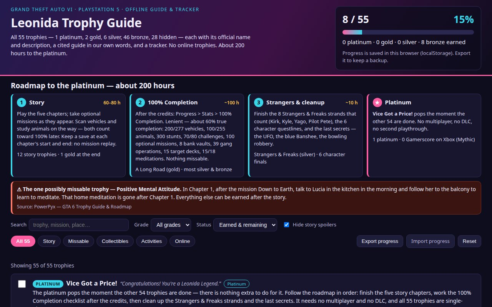
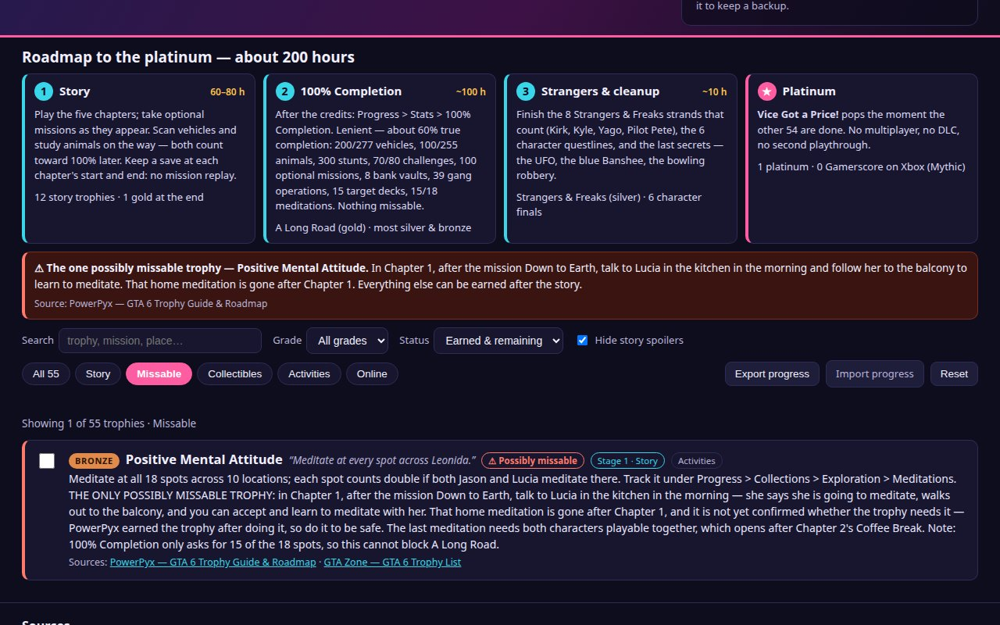
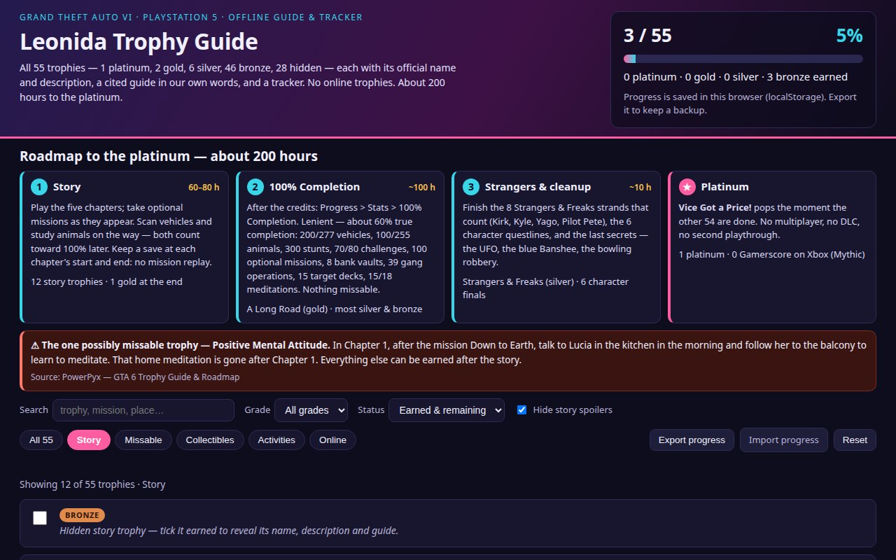
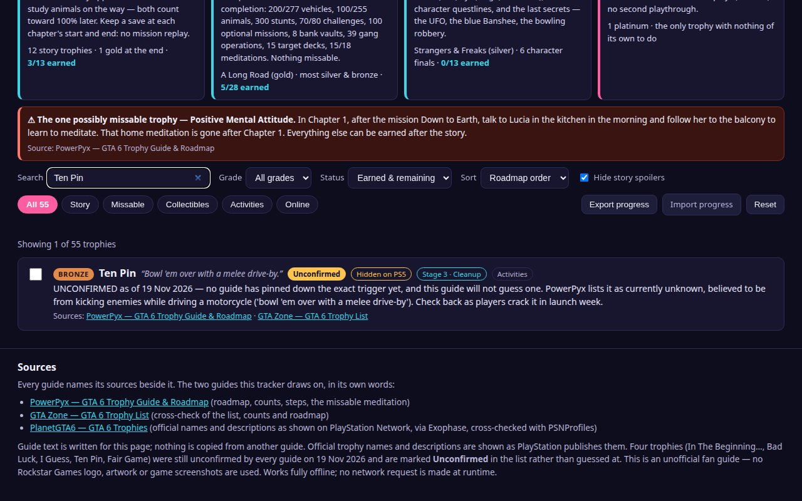

[](https://make.fun/bounty/gta6-trophy-guide-01)
[](https://make.fun/bounty/gta6-trophy-guide-01)
[](https://make.fun/bounty/gta6-trophy-guide-01)

# Leonida Trophy Guide — GTA 6

An offline, single-file trophy tracker and guide for **Grand Theft Auto VI** on PS5.
All 55 trophies — 1 platinum, 2 gold, 6 silver, 46 bronze — with a plain-English guide
for each one, a spoiler-safe view, a missable-trophy warning, and a platinum roadmap
of roughly 200 hours.

Open `app/index.html` in any browser. No server, no network, no account. Progress is
stored in your browser's localStorage and never leaves your machine.

## What it does

- **Tracker** — tick trophies off as you earn them; progress survives a reload.
- **Export / import** — save your checklist as JSON, restore it later. Import
  validates the file, drops unknown trophy ids, and tells you how many were restored.
- **Filters** — by stage (Story, Missable, Collectibles, Activities, Online), by grade
  (platinum / gold / silver / bronze), and by free-text search across names and guides.
- **Spoiler mode** — with spoilers off, story trophies you have not earned yet are
  hidden behind a warning card, so nothing about the late game is given away.
- **Sort** — roadmap order, name, grade, or stage. Your choice is remembered.
- **Next up** — a planner that suggests your next trophy: missable trophies first
  (they can be locked out forever), then the earliest story stage, with a reason and
  a jump link to the row.
- **Deep links** — every trophy has a `#trophy=<id>` link you can share or bookmark.
- **Roadmap** — a 4-stage platinum path (~200 h): story first, then open-world
  completion, then collectibles, then the long grind (100% completion).

## Trophy data — sources and honesty

The 55-trophy list was researched from live sources: **PowerPyx** (trophy list and
guides), **PSNProfiles** (trophy metadata and rarity), **GTA Zone**, and **Exophase**
(trophy list). Each trophy's guide names the source it was written from, in the
app and in `app/data/trophies.json`.

Two things are flagged honestly in the app:

- **Missable:** one trophy can be locked out if you pass its story moment without
  doing it — *Positive Mental Attitude* (meditate at the Chapter 1 balcony spot).
  The app warns you about it before you get there.
- **Unconfirmed:** eight trophies have no confirmed trigger in any public source yet
  (*Fair Game*, *In The Beginning…*, *Capital Offense*, *Personal Best*,
  *Actions Speak Louder*, *Bad Luck, I Guess*, *The Truth Is Out There*, *Ten Pin*).
  They are marked `unconfirmed` and their guides say so plainly, instead of
  guessing. When Rockstar or a guide site confirms a trigger, the entry will be
  updated.

Everything else in the list is confirmed by at least one of the sources above.

## Files

- `app/index.html` — the app shell
- `app/style.css` — all styling
- `app/app.js` — tracker, filters, planner, export/import
- `app/data/trophies.json` — the 55 trophies: names, grades, stages, guides, sources
- `main.ts` — hand-in: validates the data (55/55 guides with named sources, unique
  ids and names, stage counts) and checks each screenshot's JPEG dimensions
- `serve.ts` — serves the app locally for testing
- `shoot.mjs` — drives headless Chromium and captures the 4 screenshots
- `shots.json` — screenshot capture plan
- `screenshots/` — the 4 screenshots (cover, missable, spoilers, unconfirmed)
- `vendor/makefun-frontend.ts` — shared make.fun frontend helpers

## Verify it yourself

```sh
node main.ts            # validates data + screenshot dimensions, writes out/
node serve.ts           # serves the app on http://localhost:4173
node shoot.mjs          # re-captures the screenshots into screenshots/
node ../gta6-trophy-guide-01-kit/gta6-trophy-guide-01-kit/cli/makefun.mjs check --kit ../gta6-trophy-guide-01-kit/gta6-trophy-guide-01-kit --repo .
```

## Screenshots






## Disclaimer

Fan-made guide. Not affiliated with Rockstar Games, Take-Two Interactive, or Sony.
No Rockstar logo or official artwork is used anywhere in the app or its screenshots.

## License

MIT — see `LICENSE`.
